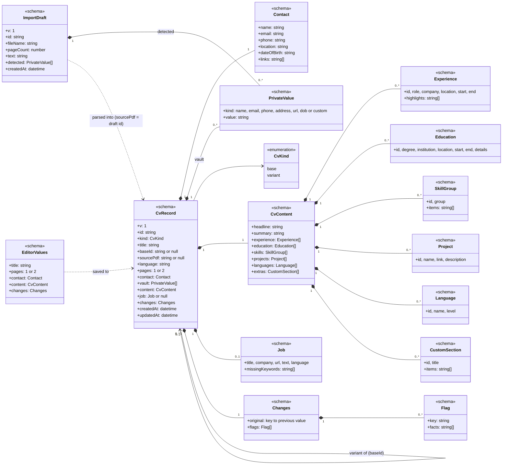

# Architecture

These diagrams describe the code **as it is now**, at the end of Phase 3: editing and export (Phase 1), PDF import with the privacy layer and the LLM adapter (Phase 2), and tailoring to job offers with tracked changes (Phase 3).

**Notation:** the code is plain TypeScript modules and React components rather than classes. Each one is drawn as a class with a stereotype:

- `<<schema>>`: a zod schema / type in `src/lib/cv/schema.ts`
- `<<module>>`: server-side code
- `<<page>>`: a Next.js route
- `<<component>>`: React UI
- `<<hook>>`: a React hook
- `<<interface>>`: the AI SDK's `LanguageModel`

Arrows mean:

- `*--`: contains
- `-->`: uses / calls
- `..>`: depends on loosely (reads/renders)
- `..|>`: implements

## 1. Data model

- **Personal data lives only in local files**: each `CvRecord` (`data/cvs/<id>.json`) holds its own `Contact` and `vault`, and `ImportDraft` (`data/imports/<id>.json`) holds raw text. Contact is a sibling of `CvContent`, never inside it. Each CV is rendered by combining its `CvContent` with its own `Contact`, so a CV imported for someone else carries that person's details.
- **The vault** holds the values the user chose to mask when the CV was imported (`PrivateValue`: custom masks, extra emails…). Outgoing LLM text is masked with the vault plus the CV's current `Contact` (`privateValuesOf`), so edited details count too, and checked against them.
- **`CvContent` is the only CV structure that is sent to an LLM**, and only after masking.
- **An `ImportDraft`** exists between upload and "Parse CV". It holds the extracted text, which still contains personal data, so it never leaves the machine. Parsing creates a `CvRecord` whose `sourcePdf` keeps the draft's PDF (`data/sources/<id>.pdf`) for the "Original PDF" tab, then deletes the draft.
- **`EditorValues`** is what the editor form edits (title, pages, contact, content, changes) and autosaves into the CV file.
- **A variant** (`kind: variant`, `baseId`) is an independent copy of the CV it was tailored from (contact and vault included), plus the `Job` it targets. Editing the base later doesn't change it.
- **`Changes`** records what tailoring or "Tighten to fit" changed, until the user reverts or keeps each change. `original` maps a key to what was there before:
  - `headline` / `summary`
  - `<section>.<entryId>`: an entry that was changed, added (`null`) or removed
  - `<section>.order`: the previous order of the entries
  - Entries are tracked by their ids, which the model must keep, so changes survive reordering.
  - `flags` are possible fabrications, each pointing at one of those keys.
- **Defaults live in the schema** (zod `.default()`). Empty CVs and blank entries are derived from it, and older files that lack a newer field (e.g. `sourcePdf`) read back with its default.

## 2. Components

```mermaid
classDiagram
  direction TB
  class LibraryPage
  <<page>> LibraryPage
  class ImportPage
  <<page>> ImportPage
  class EditorPage
  <<page>> EditorPage
  class PrintPage
  <<page>> PrintPage
  class SourceRoute {
    <<page>>
    GET original PDF
  }

  class ImportDropZone
  <<component>> ImportDropZone
  class ImportReview {
    <<component>>
    masks, what is sent, Parse
  }
  class DeleteCvButton
  <<component>> DeleteCvButton
  class Editor {
    <<component>>
    +exportPdf()
    +tighten(overflowLines)
    import banner
  }
  class TailorPanel {
    <<component>>
    job text, fetch, language, length
  }
  class ChangeControls {
    <<component>>
    useChanges, ChangeRow, ChangesBanner
    FabricationWarnings, MissingKeywords
    FieldChange, EntryChange, SectionChanges
  }
  class Fields {
    <<component>>
    Card, Grid, TextField, ItemList
    StringListField, CommaListField
  }
  class Preview {
    <<component>>
    page-fit indicator, Tighten to fit
    Preview / Original PDF or Base CV tabs
  }
  class Classic {
    <<component>>
    +render(contact, content)
  }
  class AutoPrint
  <<component>> AutoPrint
  class useAutosave {
    <<hook>>
    +status
    +flush()
  }

  class ServerActions {
    <<module>>
    +createCvAction()
    +deleteCvAction(id)
    +saveCvAction(id, fields)
    +uploadPdfAction(file)
    +parseImportAction(importId, masked)
    +cancelImportAction(importId)
    +tailorAction(cvId, job)
    +tightenAction(cvId, overflowLines)
    +fetchJobAction(url)
  }
  class Changes {
    <<module>>
    +recordChanges(previous, before, after, base, translated)
    +diffContent(before, after)
    +findFabrications(known, variant, original, translated)
    +revertChange(content, changes, key)
    +keepChange(changes, key)
    +revertAll(content, changes)
    +changeKind(original, section, id)
  }
  class JobFetcher {
    <<module>>
    +fetchJobText(url)
  }

  class PdfExtractor {
    <<module>>
    +extractLines(bytes)
  }
  class PiiDetector {
    <<module>>
    +detectPrivate(lines)
  }
  class Redactor {
    <<module>>
    TOKEN_PATTERN
    +sameValue(a, b)
    +toMasks(values)
    +redact(text, masks)
    +rehydrate(data, masks)
  }
  class PrivateValues {
    <<module>>
    +contactFromValues(values)
    +privateValuesOf(cv)
  }
  class OutboundGuard {
    <<module>>
    +assertNoPrivateData(payload, values)
  }

  class StructureCv {
    <<module>>
    +structureCv(text, privateValues)
  }
  class TailorCv {
    <<module>>
    +tailorCv(content, jobText, options, privateValues)
  }
  class TightenCv {
    <<module>>
    +tightenCv(content, overflowLines, privateValues)
  }
  class LlmContent {
    <<module>>
    +modelContentSchema(ids)
    +withIds(parsed, known)
  }
  class LlmGenerate {
    <<module>>
    +generateStructured(schema, system, prompt, privateValues)
  }
  class ProviderFactory {
    <<module>>
    +getModel()
  }
  class LanguageModel
  <<interface>> LanguageModel
  class AnthropicProvider
  class OpenAICompatibleProvider

  class CvStore {
    <<module>>
    +listCvs()
    +getCv(id)
    +createCv(title, init)
    +updateCv(id, patch)
    +deleteCv(id)
    +getBase(cv)
  }
  class ImportStore {
    <<module>>
    +createImport(pdf, draft)
    +getImport(id)
    +deleteImport(id)
    +discardImport(id)
    +discardAllImports()
  }
  class SourceStore {
    <<module>>
    +saveSourcePdf(id, pdf)
    +getSourcePdf(id)
    +deleteSourcePdf(id)
  }
  class FileStore {
    <<module>>
    +dataPath(...)
    +isSafeId(id)
    +readJson(file, schema)
    +writeFileAtomic(file, data)
    +writeJsonAtomic(file, data)
    +listJsonFiles(dir)
  }
  class PageGeometry {
    <<module>>
    PAGE, PAGE_VARS, PRINT_PAGE_CSS
    +exportFileName(name, title)
  }
  class EmptyValues {
    <<module>>
    UNTITLED_CV, shortId
    +emptyContent()
    +blankItem
  }
  class Format {
    <<module>>
    +filled(values)
    +joinFilled(values)
    +range(start, end)
    +visible(entries)
    +plural(n, word)
    +normalize(s)
    +entryValues(entry)
  }

  LibraryPage --> CvStore : listCvs
  LibraryPage --> ImportDropZone
  LibraryPage --> DeleteCvButton
  LibraryPage --> ServerActions : create
  ImportDropZone --> ServerActions : uploadPdfAction
  DeleteCvButton --> ServerActions : delete
  ImportPage --> ImportStore : getImport
  ImportPage --> ImportReview
  ImportReview --> Redactor : preview of what is sent
  ImportReview --> ServerActions : parseImportAction, cancelImportAction
  EditorPage --> CvStore : getCv
  EditorPage --> Editor
  PrintPage --> CvStore
  PrintPage --> Classic
  PrintPage --> AutoPrint
  PrintPage --> PageGeometry
  SourceRoute --> CvStore
  SourceRoute --> SourceStore : getSourcePdf

  Editor --> Fields
  Editor --> Preview
  Editor --> TailorPanel
  Editor --> ChangeControls
  Editor --> ServerActions : tightenAction
  Fields --> ChangeControls : entry and section notes
  ChangeControls --> Changes : revert, keep
  Fields --> Changes : changeKind
  TailorPanel --> ServerActions : tailorAction, fetchJobAction
  Editor --> useAutosave
  Editor --> Format : entry summaries
  Fields --> EmptyValues : blankItem
  Classic --> Format
  useAutosave --> ServerActions : saveCvAction
  Preview --> Classic
  Preview --> PageGeometry
  Preview ..> SourceRoute : Original PDF tab
  EditorPage --> CvStore : getBase (Base CV tab)

  ServerActions --> PdfExtractor
  ServerActions --> PiiDetector
  ServerActions --> StructureCv
  ServerActions --> TailorCv
  ServerActions --> TightenCv
  ServerActions --> JobFetcher
  ServerActions --> Changes : recordChanges
  ServerActions --> CvStore
  ServerActions --> ImportStore
  ServerActions --> PrivateValues : contactFromValues, privateValuesOf

  StructureCv --> LlmGenerate
  TailorCv --> LlmGenerate
  TightenCv --> LlmGenerate
  StructureCv --> LlmContent
  TailorCv --> LlmContent
  TightenCv --> LlmContent
  LlmGenerate --> Redactor : mask before, restore after
  LlmGenerate --> OutboundGuard : every call
  LlmGenerate --> ProviderFactory
  ProviderFactory ..> LanguageModel : creates
  AnthropicProvider ..|> LanguageModel
  OpenAICompatibleProvider ..|> LanguageModel

  PiiDetector --> Redactor : sameValue
  PrivateValues --> Redactor : sameValue
  CvStore --> FileStore
  CvStore --> SourceStore : deleteSourcePdf
  ImportStore --> SourceStore : save / delete PDF
  ImportStore --> FileStore
  SourceStore --> FileStore
  CvStore --> EmptyValues
```

- **Every LLM call goes through `LlmGenerate.generateStructured`.** It masks the prompt with `Redactor` (the same `redact` the Import screen uses for its "What's sent" preview, so the preview is exactly what is sent). `OutboundGuard` then blocks the request if any private value is still present, even reformatted (e.g. a phone number with different separators), before anything leaves the machine. The model's answer is rehydrated locally: placeholders such as `{{URL_2}}` become the real values again.
- **Vendor-agnostic:** only `ProviderFactory` knows about vendors, and it picks one from `.env` (`LLM_PROVIDER`, `LLM_MODEL`, `LLM_API_KEY`, `LLM_BASE_URL`). `anthropic` uses Claude; `openai-compatible` covers OpenRouter, Ollama, LM Studio and similar.
- **Import is two steps.**
  1. `uploadPdfAction` reads the PDF locally (`PdfExtractor`, pdf.js) and finds personal details (`PiiDetector`, regexes and font size, no network). It stores an `ImportDraft`.
  2. `parseImportAction` sends the masked text to the model (`StructureCv`) and creates the CV. The new CV's `Contact` comes from the values the user kept masked (`contactFromValues`), and those values also become its vault.
  3. **Cancel import** discards the draft and its PDF. Leftovers from imports that were never parsed (e.g. the tab was closed) are discarded at the next upload, so unmasked CV text doesn't pile up in `data/imports/`.
- **Tailoring creates a variant.**
  - `tailorAction` sends the CV content (never `Contact`) and the job text. Both are masked with that CV's private values (`privateValuesOf`), so personal details in a pasted posting are masked too. The variant copies the CV's contact and vault.
  - Entry ids are kept, and `withIds` replaces any id the model invents or repeats.
  - `recordChanges` records every change (`diffContent`) and flags new facts (employers, roles, dates, degrees, skills) that appear neither in the base CV nor in what the user had before this round, so anything they kept stays kept (`findFabrications`). That check is done locally, not by the model.
  - When the variant is in another language than its base, only language-neutral facts are checked: employers, schools, dates, links and skills. The import step detects each CV's language for this.
  - Revert and Keep (`revertChange`, `keepChange`) update the changes and their flags together.
- **"Tighten to fit"** shortens a CV in place the same way. The editor is locked while it runs, and the action only writes if the CV wasn't saved in the meantime, so no edit is lost. Its changes are merged with earlier ones (the earliest version wins), so Revert always goes back to what you had.
- **Job pages are fetched best-effort** (`JobFetcher`: Readability + linkedom). Pasting the text is the main way in.
- **Pages read data on the server** via the stores; **every write goes through `ServerActions`**, which validate their input with zod. Client components never touch the file system.
- **Only `lib/store/*` uses `node:fs`.** Every file (JSON and PDF) is written atomically through `FileStore.writeFileAtomic`, and JSON is validated on every read. Ids from URLs are checked with `isSafeId`, so a URL can't reach outside `DATA_DIR`.
- **Personal data:**
  - **Read or written by:** `CvStore` (contact + vault, per CV), `ImportStore` (draft text), `SourceStore` (original PDFs) and the import actions.
  - **Shown by:** `Classic`, the editor's Contact card and `ImportReview`.
  - **Sent to the model:** only masked text, via `LlmGenerate`: import (the values the user kept masked), and tailoring and tightening (that CV's contact and vault).
