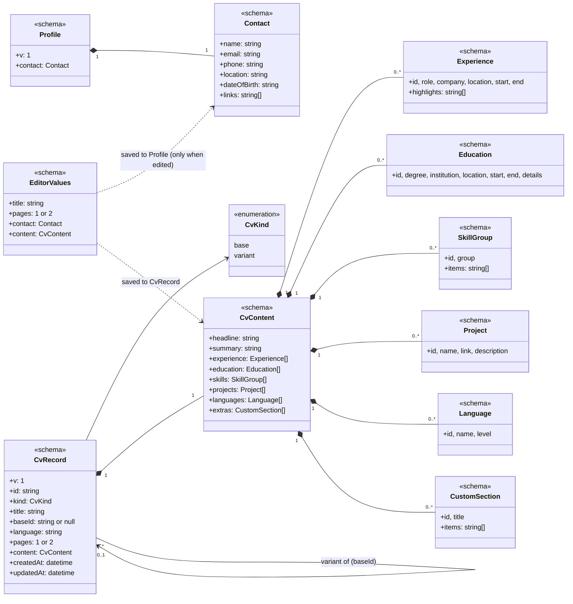
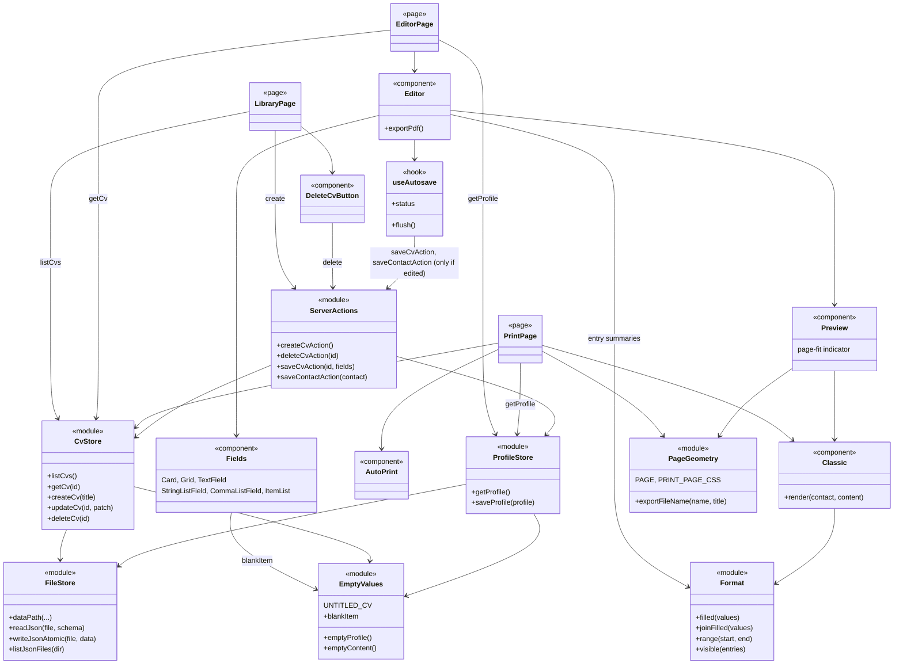

# Architecture

These diagrams describe the code **as it is now**, at the end of Phase 1: no AI yet. Components planned for Phases 2–3 (import, privacy layer, LLM adapter, tailoring) are drafted in [plan.md](plan.md#architecture-documentation-class-diagrams) and move here when they're built.

**Notation:** the code is plain TypeScript modules and React components rather than classes. Each one is drawn as a class with a stereotype:

- `<<schema>>`: a zod schema / type in `src/lib/cv/schema.ts`
- `<<module>>`: server-side code
- `<<page>>`: a Next.js route
- `<<component>>`: React UI
- `<<hook>>`: a React hook

Arrows mean:

- `*--`: contains
- `-->`: uses / calls
- `..>`: depends on loosely (reads/renders)

## 1. Data model

- **Contact details live only in `Profile`**, one per installation, stored in `data/profile.json`. A `CvRecord` (`data/cvs/<id>.json`) never contains them. Every CV is rendered by combining its `CvContent` with the profile's `Contact`.
- **`CvContent` is the only structure that may ever be sent to an LLM** (from Phase 2). Keeping `Contact` out of it by construction is what the privacy rules rely on.
- **`EditorValues`** is what the editor form edits. On save it is split: the CV fields go to the CV file, and `contact` goes to the profile only when it was edited in that editor. That way an editor open on another CV can't overwrite newer contact details.
- **`kind` / `baseId`** are already in the file format, so tailored variants (Phase 3) need no migration. Today every CV is a `base`.
- **Defaults live in the schema** (zod `.default()`). `EmptyValues` derives empty CVs and blank entries from it, and older files that lack a newer field read back with its default.

## 2. Components

- **Pages read data on the server** via the stores (`getCv`, `getProfile`, `listCvs`). **Every write goes through `ServerActions`**, which validate their input with zod before calling a store. Client components never touch the file system.
- **`CvStore.updateCv` owns the merge and `updatedAt`.** `createCv` never reuses an existing id.
- **Only `FileStore` uses `node:fs`.** It validates every read with the zod schemas and writes atomically (temp file + rename). `CvStore` also rejects ids that aren't plain slugs, so a URL can't reach outside `DATA_DIR`.
- **One template, two consumers.** `Classic` is pure markup, used both by the live `Preview` and by the print route. Both take the A4 size and margins from `PageGeometry`, so the page-fit indicator and the exported PDF agree.
- **Personal data in Phase 1:** contact details are read and written only by `ProfileStore`, and shown by `Classic` and the editor's Contact card. Nothing is sent outside the machine yet. From Phase 2, the privacy layer and the LLM adapter (see the plan) attach to `ServerActions`.
