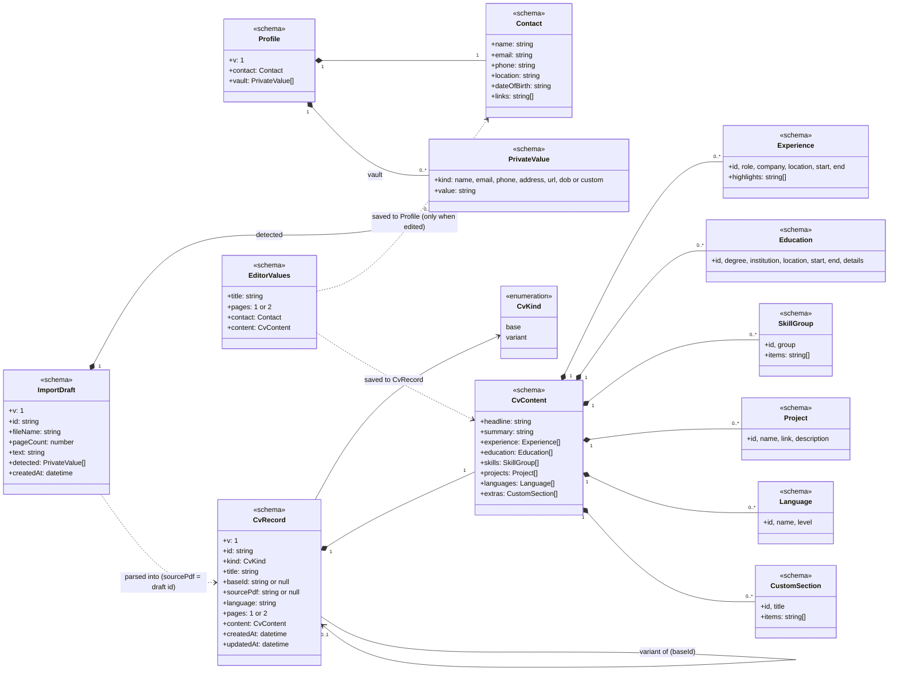
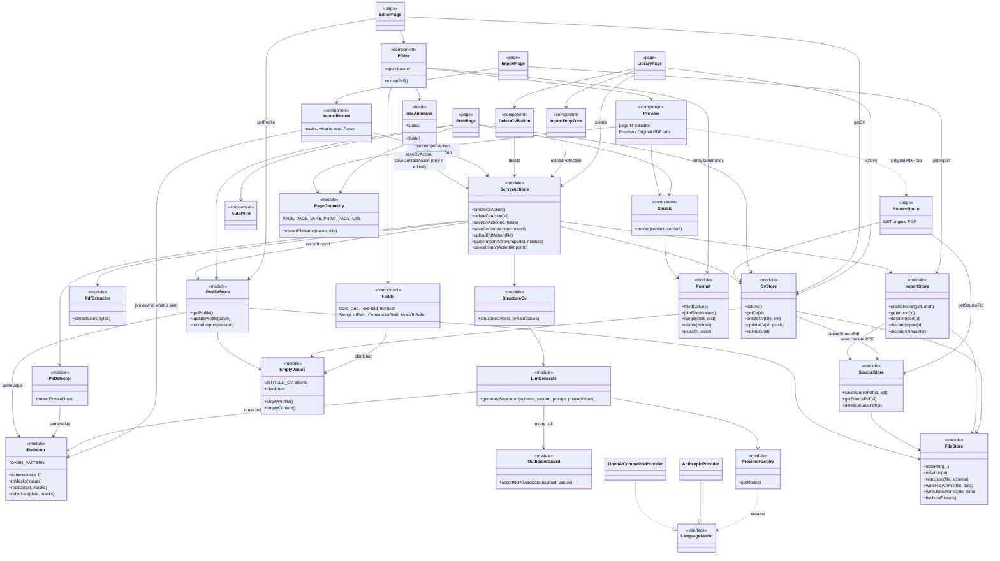

# Architecture

These diagrams describe the code **as it is now**, at the end of Phase 2: editing and export (Phase 1), plus PDF import with the privacy layer and the LLM adapter. Tailoring (Phase 3) is drafted in [plan.md](plan.md#architecture-documentation-class-diagrams) and moves here when it is built.

**Notation:** the code is plain TypeScript modules and React components rather than classes. Each one is drawn as a class with a stereotype:

- `<<schema>>`: a zod schema / type in `src/lib/cv/schema.ts`
- `<<module>>`: server-side code
- `<<page>>`: a Next.js route
- `<<component>>`: React UI
- `<<hook>>`: a React hook
- `<<interface>>`: the AI SDK's `LanguageModel`

Arrows mean:

- `*--`: contains
- `-->`: uses / calls
- `..>`: depends on loosely (reads/renders)
- `..|>`: implements

## 1. Data model

- **Personal data lives only in `Profile` and `ImportDraft`**, both local files: `data/profile.json` and `data/imports/<id>.json`. A `CvRecord` (`data/cvs/<id>.json`) never holds `Contact`. Every CV is rendered by combining its `CvContent` with the profile's `Contact`.
- **The vault** holds every value the user chose to mask in an import (`PrivateValue`). Outgoing LLM text is masked with those values and checked against them.
- **`CvContent` is the only CV structure that is sent to an LLM**, and only after masking.
- **An `ImportDraft`** exists between upload and "Parse CV". It holds the extracted text, which still contains personal data, so it never leaves the machine. Parsing creates a `CvRecord` whose `sourcePdf` keeps the draft's PDF (`data/sources/<id>.pdf`) for the "Original PDF" tab, then deletes the draft.
- **`EditorValues`** is what the editor form edits. On save it is split: the CV fields go to the CV file, and `contact` goes to the profile only when it was edited in that editor.
- **`kind` / `baseId`** are already in the file format, so tailored variants (Phase 3) need no migration. Today every CV is a `base`.
- **Defaults live in the schema** (zod `.default()`). Empty CVs and blank entries are derived from it, and older files that lack a newer field (e.g. `sourcePdf`, `vault`) read back with its default.

## 2. Components

- **Every LLM call goes through `LlmGenerate.generateStructured`.** It masks the prompt with `Redactor` (the same `redact` the Import screen uses for its "What's sent" preview, so the preview is exactly what is sent). `OutboundGuard` then blocks the request if any private value is still present, even reformatted (e.g. a phone number with different separators), before anything leaves the machine. The model's answer is rehydrated locally: placeholders such as `{{URL_2}}` become the real values again.
- **Vendor-agnostic:** only `ProviderFactory` knows about vendors, and it picks one from `.env` (`LLM_PROVIDER`, `LLM_MODEL`, `LLM_API_KEY`, `LLM_BASE_URL`). `anthropic` uses Claude; `openai-compatible` covers OpenRouter, Ollama, LM Studio and similar.
- **Import is two steps.**
  1. `uploadPdfAction` reads the PDF locally (`PdfExtractor`, pdf.js) and finds personal details (`PiiDetector`, regexes and font size, no network). It stores an `ImportDraft`.
  2. `parseImportAction` sends the masked text to the model (`StructureCv`), records the import in the profile, and creates the CV. `recordImport` fills only empty contact fields, and only from values the user kept masked, so an import never overwrites the shared contact details. It also adds the masked values to the vault.
  3. **Cancel import** discards the draft and its PDF. Leftovers from imports that were never parsed (e.g. the tab was closed) are discarded at the next upload, so unmasked CV text doesn't pile up in `data/imports/`.
- **Pages read data on the server** via the stores; **every write goes through `ServerActions`**, which validate their input with zod. Client components never touch the file system.
- **Only `lib/store/*` uses `node:fs`.** Every file (JSON and PDF) is written atomically through `FileStore.writeFileAtomic`, and JSON is validated on every read. Ids from URLs are checked with `isSafeId`, so a URL can't reach outside `DATA_DIR`.
- **Personal data:**
  - **Read or written by:** `ProfileStore` (contact + vault), `ImportStore` (draft text), `SourceStore` (original PDFs) and the import actions.
  - **Shown by:** `Classic`, the editor's Contact card and `ImportReview`.
  - **Sent to the model:** only masked text, via `LlmGenerate`.
