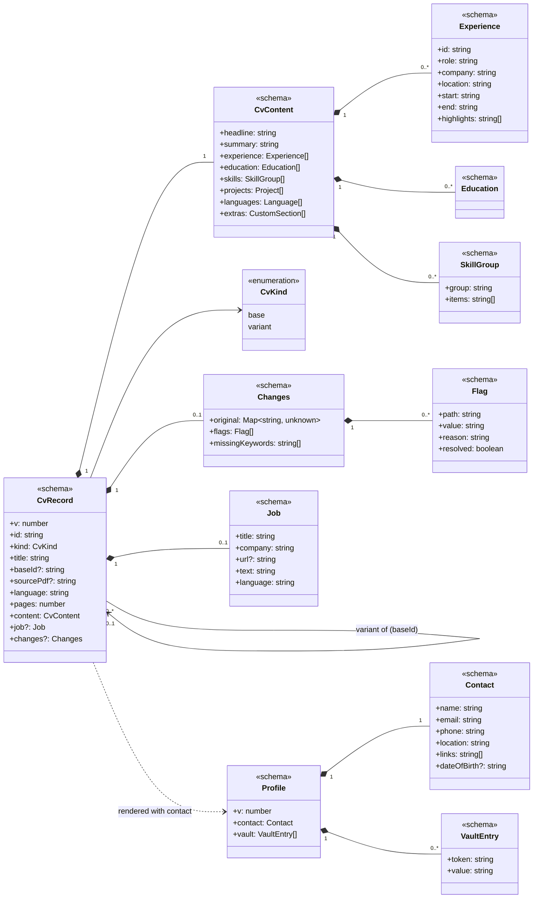
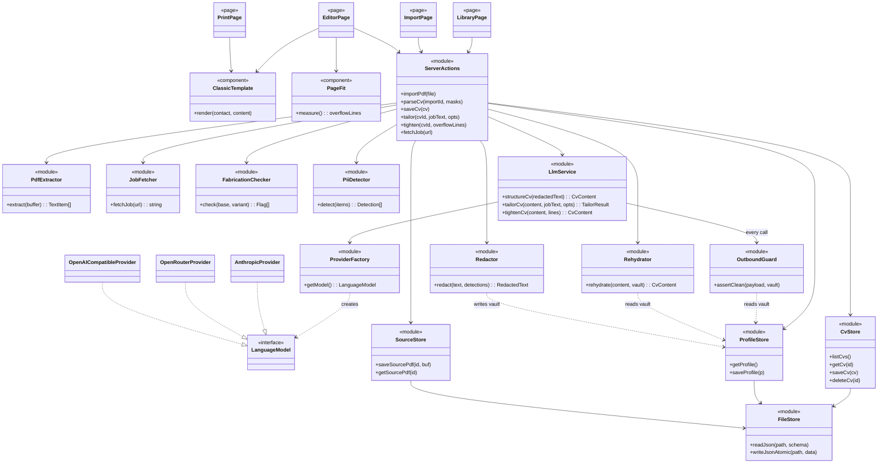

# CV Tool: Project Plan (v2, simplified)

## Context

A personal tool, for me plus at most 2–3 other people, each running their own copy. It keeps one or more base CVs and many tailored variants, one per job application.

1. **Import & edit**: drop a CV PDF → parse it into structured fields → fix the result in a form with the original PDF alongside → export to PDF.
2. **Tailor**: from a CV, paste the job description (a URL is optional) → a new variant opens in the same editor with the changes highlighted → edit → export.

Constraints:

- **No personal data goes to the LLM provider.** Contact details are masked locally, and only anonymised text is sent.
- **Vendor agnostic.** Claude now; OpenRouter, OpenAI or a local model (Ollama) later, by changing `.env` only.
- **No overengineering.** Next.js + TypeScript on Bun (package manager, scripts, tests), local only, no auth, one template, no settings UI.

UI mockups: https://claude.ai/artifact/BLt5UVRZijW8LjVAkXmEf5 (v2 row = this plan; the v1 row is kept for comparison).

## Screens (3)

1. **Library** (`/`): a drop zone, then each base CV with its variants listed underneath (role · company · language · date · Edit / PDF).
2. **Import** (`/import`): one screen. Masked details are shown as chips (unmask one, or mask selected text), a collapsible "What's sent" panel shows the exact outgoing text, and a **Parse CV** button.
3. **Editor** (`/cv/[id]`): the form on the left; the right pane has two tabs, **Preview** and **Original PDF** (or **Base CV** when viewing a variant).
   - After import: a banner asking you to compare with the original, and a "Move to…" menu on each highlight to move it to another role or section.
   - Page-fit indicator ("Fits on 1 page" / "4 lines over 1 page") with **Tighten to fit**.
   - **Tailor…** opens a panel in place of the right pane: job description textarea (main input), optional URL + Fetch, output language, length (1 or 2 pages), and **Create tailored variant**.
   - Variant mode: changed fields are highlighted with "Was: …" and **Revert** per field (plus Revert all). A fabrication warning appears only when the check finds something new. A "Not in your CV" keyword list.
   - **Export PDF** uses the browser's print to PDF. The default filename is `First-Last_Company.pdf`.

Out of scope for now: a settings page, a second template, keyword scores, per-change accept/reject cards, keeping variants in sync with their base, cover letters, OCR, auth.

## Architecture

```
Browser                                  Next.js server (localhost)                       External
Drop PDF ─► upload ────────────────────► pdf.js text extraction (local)
                                         PII detect/redact ─► vault in profile.json
Import screen ◄── redacted text + chips ◄┘
"Parse CV" ────────────────────────────► guard ─► LLM adapter ─────────────────────────► Claude / OpenRouter / Ollama
Editor ◄── rehydrated CV JSON ◄──────────┘   (structured output, zod)
Preview (same React template) ─► window.print() with @page CSS ─► PDF
```

### Privacy layer

- `lib/privacy/detect.ts`: finds name (from the first lines / largest font in the pdf.js text items), email, phone, URLs, postal address and date of birth. Photos are never sent.
- `lib/privacy/redact.ts`: replaces each value with a stable token (`{{NAME}}`, `{{EMAIL}}`, `{{URL_1}}`…) and puts the real values in the **vault**. Custom masks added on the Import screen go into the vault too.
- `lib/privacy/guard.ts`: every LLM call goes through it. It throws if the outgoing payload contains any vault value (ignoring case and whitespace).
- The CV's `contact` block is **never** in an LLM payload. It lives only in `profile.json` and is merged back in locally when rendering.
- Tailoring sends the CV content without contact details, so the Tailor panel has no review step, just one line explaining what is sent.

### LLM adapter (vendor agnostic)

- Vercel AI SDK `generateObject` with zod schemas.
- `lib/llm/provider.ts` reads `LLM_PROVIDER=anthropic|openrouter|openai-compatible`, `LLM_MODEL`, `LLM_API_KEY`, `LLM_BASE_URL`. Packages: `@ai-sdk/anthropic`, `@openrouter/ai-sdk-provider`, `@ai-sdk/openai-compatible`.
- Three operations in `lib/llm/index.ts`, each wrapped by the guard:
  - `structureCv(redactedText)`: returns `CvContent`.
  - `tailorCv(content, jobText, { language, pages })`: returns `CvContent` plus `missingKeywords[]` and `jobMeta {title, company, language}`.
  - `tightenCv(content, overflowLines)`: returns a shortened `CvContent`.

### CV data model (`lib/cv/schema.ts`, zod, the single source of truth)

- `Contact` (local only): name, email, phone, location, links[], dateOfBirth?
- `CvContent` (the only part that can reach the LLM): headline, summary, experience[] (id, role, company, location, start, end, highlights[]), education[], skills[] (group, items[]), projects[], languages[], extras[] (custom sections).
- The same schema drives the form (react-hook-form + zodResolver), LLM structured output, the template and storage.

## Persistence layer

**Decision: plain JSON files in a local data folder, with no database.** For one user and a few dozen CVs, files are easy to read, back up, diff and delete. They need no native dependencies and no migrations tooling. Nothing is shared between users; each person runs their own copy with their own folder.

**Location:** `DATA_DIR` env var, default `./data` (gitignored). Back it up by copying the folder, or keep it in a private git repo.

```
data/
  profile.json            # contact details + PII vault (the only personal data)
  cvs/
    <id>.json             # one file per base CV or variant
  sources/
    <id>.pdf              # original PDF of an imported base CV (for the "Original PDF" tab)
```

**`profile.json`**

```jsonc
{
  "v": 1,
  "contact": {
    "name": "…",
    "email": "…",
    "phone": "…",
    "location": "…",
    "links": ["…"],
    "dateOfBirth": null,
  },
  "vault": [
    { "token": "{{NAME}}", "value": "…" },
    { "token": "{{CUSTOM_1}}", "value": "…" },
  ],
}
```

There is one profile per installation, because each person runs their own copy. All CVs share it, so contact details are stored once and every variant renders with the current values.

**`cvs/<id>.json`**

```jsonc
{
  "v": 1,
  "id": "senior-backend-k3f9",          // slug + 4 random chars
  "kind": "base" | "variant",
  "title": "Senior Backend Engineer",
  "baseId": null,                         // variants: id of the base they came from
  "sourcePdf": "senior-backend-k3f9.pdf", // base CVs created by import; otherwise null
  "language": "en",
  "pages": 1,                             // target length
  "content": { /* CvContent */ },
  "job": {                                // variants only
    "title": "…", "company": "…", "url": null, "text": "…", "language": "en"
  },
  "changes": {                            // set by tailoring or Tighten to fit; drives highlights and Revert
    "original": { "headline": "…", "summary": "…", "experience.0.highlights": ["…"] },  // previous values of changed paths
    "flags": [ { "path": "skills.1.items", "value": "Terraform Cloud", "reason": "not in base CV", "resolved": false } ],
    "missingKeywords": ["Developer tooling", "PagerDuty"]   // variants only
  },
  "createdAt": "…", "updatedAt": "…"
}
```

- **Changed fields** = the keys of `changes.original`. **Revert** copies that value back into `content` and removes the key; **Revert all** does this for every key. Editing a highlighted field by hand keeps the highlight until you revert it or click "Mark as reviewed", which removes the key.
- Variants are **independent copies**: editing the base later does not change them (on purpose).

**Access layer:** `lib/store/` is the only code that touches the file system. If storage ever changes (e.g. to SQLite), only these files do.

- `profile.ts`: `getProfile()`, `saveProfile()`
- `cvs.ts`: `listCvs()` (reads the folder; grouping variants under their base comes with Phase 3), `getCv(id)`, `createCv(title)`, `updateCv(id, patch)` (merges and stamps `updatedAt`), `deleteCv(id)` (deleting a base asks first and deletes its variants and source PDF)
- `sources.ts`: `saveSourcePdf(id, buffer)`, `getSourcePdf(id)`

**Rules:**

- Every read is validated with zod. Each file has a `v` field so its format can be upgraded on read.
- Writes are atomic: write `<file>.tmp`, then rename it over the original.
- The editor autosaves through a server action, debounced by about 800 ms. With a single user, the last write wins.
- Only server code (route handlers and server actions) uses `lib/store`; the browser never reads the folder directly.

## Key implementation notes

- **PDF in:** `unpdf` (pdf.js) on the server; text items with font sizes help detect the name and headings. A PDF with no text layer gets a clear error and an option to start from an empty CV.
- **Original PDF tab:** render `sources/<id>.pdf` with pdf.js in the browser. Highlighting the source line behind a selected field is a nice-to-have.
- **Template & export:** one React template, `templates/Classic.tsx`, used by the preview and by a print-only route `/cv/[id]/print`, with `@page { size: A4; margin: … }`. Export opens that route and calls `window.print()`. Setting `document.title` to `First-Last_Company` makes that the default filename.
- **Page fit:** the preview renders at real A4 size (mm units). Compare the content height with the page height and convert the overflow to lines. **Tighten to fit** calls `tightenCv`; it records the previous values in `changes.original`, so its edits are highlighted with Revert, the same way as tailoring.
- **Fabrication check** (`lib/cv/fabrication.ts`, no LLM): compares the sets of companies, roles, dates, degrees and skill items between the variant and its base. Anything new becomes a `flags[]` entry, shown as the warning banner (Remove / Keep).
- **Job input:** pasted text is the main input. Fetch is best effort: server-side `fetch` + `@mozilla/readability` + `jsdom`, and on failure the message says to paste the text instead.
- **"Move to…"** in the editor: moves a highlight to another role or section. This is pure client state, saved by autosave.

## Architecture documentation: class diagrams

**Deliverable:** `docs/architecture.md`, with two Mermaid `classDiagram`s that GitHub and VS Code render without extra tooling.

1. **Data model:** the zod schemas and how they relate (composition, cardinality, variant → base).
2. **Components:** the modules, what each one depends on, and the paths data takes (privacy boundary, LLM adapter, storage).

The code is mostly functional TypeScript modules rather than classes, so in the diagrams each module is drawn as a class with a stereotype: `<<schema>>` for zod types, `<<module>>` for server code, `<<page>>` / `<<component>>` for UI, and `<<interface>>` for the AI SDK model. Each diagram is followed by a short legend and 3–5 sentences explaining the main relations, especially **which components may see personal data.**

**Upkeep rule:** the diagram is written at the start of Phase 1 from the draft below. It is updated in the same change as any code that adds, removes or rewires a component or schema. A phase is not done until the diagram matches the code.

### Draft 1: data model



Key point: `Contact` and `VaultEntry` exist only inside `Profile`. `CvContent` is the only structure that can be sent to the LLM.

### Draft 2: components



Key points:

- `ServerActions` is the only thing that coordinates the other modules; pages never call stores or the LLM directly.
- `LlmService` cannot reach a provider without going through `OutboundGuard`.
- Only the privacy modules and `ProfileStore` handle the vault.

## Delivery phases

Four phases: Phase 0 (mockups) is done, and Phases 1–3 are the build. Each build phase produces a working app.

**Phase 0: Mockups.** Done (v2 row on the canvas).

**Phase 1: Foundation, no AI.** ✅ Done (2026-10-05). Copy this plan to `docs/plan.md` · `docs/architecture.md`, with both class diagrams written from the drafts above · `bun run check` (`tsc --noEmit`, ESLint, Prettier, `knip`, `jscpd`) · `bun create next-app` (TS, App Router, Tailwind; Bun as package manager) · zod schema · `lib/store` + `profile.json` · Library · Editor form + Classic template preview · page-fit indicator · print export. Done when a CV can be created by hand, edited, autosaved and exported, and the diagrams match the code.

**Phase 2: Import.** Upload + `unpdf` extraction · detect/redact/vault · Import screen (chips, What's sent, Parse) · LLM adapter + guard + `structureCv` · Original PDF tab · Move to… menu · diagrams updated.

**Phase 3: Tailor.** Tailor panel (paste / fetch, language, length) · `tailorCv` · variant creation with `changes.original` · highlights + Revert · fabrication check · missing keywords · Tighten to fit · diagrams updated.

**Every phase ends with the Definition of done in `CLAUDE.md`:** `bun run check` + `bun test` pass → `/simplify` → `/code-review` → diagrams up to date → UI tried in the browser.

## Key files

- `CLAUDE.md`: project rules (privacy, persistence, lean-code rules, definition of done)
- `src/lib/cv/{schema,empty,format,page}.ts` (+ `fabrication.ts` in Phase 3). Empty values come from zod `.default()`s in the schema.
- `src/lib/store/{profile,cvs,sources,fs}.ts`: `fs.ts` holds the atomic write and the zod-validated read
- `src/lib/privacy/{detect,redact,rehydrate,guard}.ts`
- `src/lib/llm/{provider,structure,tailor,tighten,index}.ts`
- `src/lib/pdf/extract.ts`, `src/lib/job/fetch.ts`
- `src/templates/Classic.tsx`, `src/templates/print.css`
- `src/app/page.tsx` (Library), `src/app/import/page.tsx`, `src/app/cv/[id]/page.tsx`, `src/app/cv/[id]/print/page.tsx`, `src/app/actions.ts` (server actions)
- `.env.example`: `LLM_PROVIDER`, `LLM_MODEL`, `LLM_API_KEY`, `LLM_BASE_URL`, `DATA_DIR`
- `docs/architecture.md`: the class diagrams (data model + components) with short explanations

## Verification

- **Unit (`bun test`):** the detector against 3–4 fixture CVs; redact → rehydrate round trip; the guard throws when a vault value is in the payload; store round trip (save → read → zod-valid) and the atomic write leaves no partial file; fabrication check cases.
- **Privacy test:** a mock LLM provider records every request. Run import + tailor + tighten and assert that no vault value appears in any request.
- **Diagrams:** both Mermaid blocks render without errors (GitHub preview or `bunx @mermaid-js/mermaid-cli`). At the end of each phase, check every module in `src/lib/**` and every schema in `schema.ts` against the diagram: each must appear, with no extras and no missing arrows.
- **Manual end-to-end:** import a real CV → compare with the original and fix → export (one page, correct filename) → tailor with pasted job text → revert a field → export the variant. Then switch `.env` to Ollama and repeat the import.
