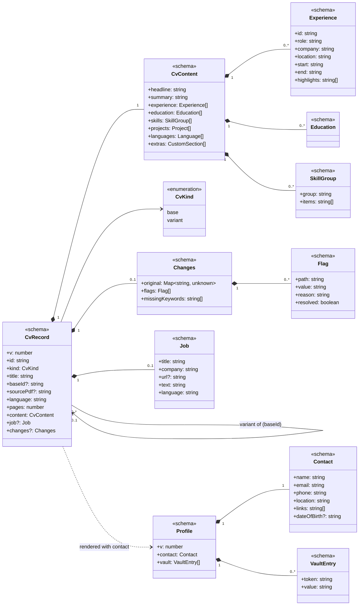

# CV Tool: Project Plan (v3)

> **Superseded in one respect:** contact details and the PII vault are now stored per CV (`contact` and `vault` in `cvs/<id>.json`), not in a shared `profile.json`. Where this plan says `Profile` or `profile.json`, see `docs/architecture.md` for the current design.

## Current status (2026-10-09)

- **Phase 1:** done and committed.
- **Phase 2 (import):** done.
  - The `/simplify` and `/code-review` findings are fixed. The 6 review findings were: date ranges masked as phones; contact filled from rejected values; drop-zone re-pick and double drop; duplicate custom mask; fit status unmeasured behind the Original tab; abandoned imports left on disk.
  - `bun run check` passes, and `bun test` passes 24 tests.
  - Both browser flows pass, and the fake model received 0 of 7 personal values.
- **Phase 3 (tailoring):** done.
  - `/simplify` and `/code-review` are applied. The 4 review findings were: tighten could lose edits made during the call; translated facts were flagged as fabrications; kept facts were re-flagged; an orphaned variant used itself as its base.
  - `bun test` passes 35 tests, and all three browser flows pass with no personal data sent to the (fake) model.
- **After Phase 3 (from user feedback):**
  - Contact details and the vault moved from `profile.json` onto each CV, so importing someone else's CV shows their own details.
  - A date of birth without a label is detected (header only, age 16–80).
  - Job titles are no longer dropped on import: the schema sent to the model marks every field required.
  - The "Move to…" menu on highlights was removed.
  - Real model calls run through OpenRouter (`deepseek/deepseek-v4.1-flash`).
- **Phase 4 (match report):** done (2026-10-06). `/simplify` and `/code-review` applied; the 3 review findings were a stale report after editing the job text mid-analysis, "Atualmente"/"Actualidad" not read as present, and year-first dates ("2019-03") losing their month. `bun test` passes 48 tests; analyze → confirm → tailor ran end to end against the real model with a made-up CV. The "single-column template" readability check moves to Phase 5.
- **Phase 5 (templates):** done (2026-10-06). `/simplify` and `/code-review` applied; the one review finding was a stray " | " in Sidebar for a role without a company. All three templates and the picker were checked in headless Firefox screenshots; `bun test` passes 48 tests.
- **Phase 6 (review):** done (2026-10-07). `/simplify` and `/code-review` applied; the 9 review findings included two privacy leaks in instruction scanning (a name opening the instruction, names with inner capitals), a name excused by a longer one in the CV, new numbers lost on an already-flagged entry, the user's own numbers flagged, applying a review of an older version of the CV, and digits in names like S3. `bun test` passes 63 tests; review → apply → own instruction ran against the real model with a made-up CV, and in headless Firefox on a base CV and a variant.
- **Phase 7 (choose the model, see the cost):** done (2026-10-08). The OpenRouter check confirmed that `usage.cost` comes back by default and that `provider: { zdr: true }` is enforced (a model without zero-retention endpoints is refused with a 404). `/simplify` and `/code-review` applied; the review findings were: a broken `LLM_MODELS` blocked the editor even for manual editing, the README still described `LLM_MODEL`, model ids from the browser weren't validated with zod, and the banner credited every change to the last run. `bun test` passes 71 tests and `bun run e2e` 6; every picker and result was checked in Playwright screenshots against the mock model. Mockups: the v5 row.
- **Phase 8 (a review you control):** planned (2026-10-09). Mockups: the v6 row.

## Context

A personal tool, for me plus at most 2–3 other people, each running their own copy. It keeps one or more base CVs and many tailored variants, one per job application.

1. **Import & edit**: drop a CV PDF → parse it into structured fields → fix the result in a form with the original PDF alongside → export to PDF.
2. **Tailor**: from a CV, paste the job description (a URL is optional) → a new variant opens in the same editor with the changes highlighted → edit → export.

Constraints:

- **No personal data goes to the LLM provider.** Contact details are masked locally, and only anonymised text is sent.
- **Vendor agnostic.** Claude now; OpenRouter, OpenAI or a local model (Ollama) later, by changing `.env` only.
- **No overengineering.** Next.js + TypeScript on Bun (package manager, scripts, tests), local only, no auth, one template, no settings UI.

UI mockups: https://claude.ai/artifact/BLt5UVRZijW8LjVAkXmEf5 (v2 row = this plan; the v1 row is kept for comparison).

## Screens (3)

1. **Library** (`/`): a drop zone, then each base CV with its variants listed underneath (role · company · language · date · Edit / PDF).
2. **Import** (`/import`): one screen. Masked details are shown as chips (unmask one, or mask selected text), a collapsible "What's sent" panel shows the exact outgoing text, and a **Parse CV** button.
3. **Editor** (`/cv/[id]`): the form on the left; the right pane has two tabs, **Preview** and **Original PDF** (or **Base CV** when viewing a variant).
   - After import: a banner asking you to compare with the original.
   - Page-fit indicator ("Fits on 1 page" / "4 lines over 1 page") with **Tighten to fit**.
   - **Tailor…** opens a panel in place of the right pane: job description textarea (main input), optional URL + Fetch, output language, length (1 or 2 pages), and **Create tailored variant**.
   - Variant mode: changed fields are highlighted with "Was: …" and **Revert** per field (plus Revert all). A fabrication warning appears only when the check finds something new. A "Not in your CV" keyword list.
   - **Export PDF** uses the browser's print to PDF. The default filename is `First-Last_Company.pdf`.

Out of scope for now: a settings page, a second template, keyword scores, per-change accept/reject cards, keeping variants in sync with their base, cover letters, OCR, auth.

## Architecture

```
Browser                                  Next.js server (localhost)                       External
Drop PDF ─► upload ────────────────────► pdf.js text extraction (local)
                                         PII detect/redact ─► vault in profile.json
Import screen ◄── redacted text + chips ◄┘
"Parse CV" ────────────────────────────► guard ─► LLM adapter ─────────────────────────► Claude / OpenRouter / Ollama
Editor ◄── rehydrated CV JSON ◄──────────┘   (structured output, zod)
Preview (same React template) ─► window.print() with @page CSS ─► PDF
```

### Privacy layer

_(As built in Phase 2.)_

- `lib/privacy/detect.ts`: `detectPrivate(lines)` finds the name (largest font in the header), email, phone, URLs, postal address and date of birth, locally. It deliberately over-detects, because unmasking a value is one click on the Import screen. Photos are never sent.
- `lib/privacy/redact.ts`:
  - `toMasks(values)`: assigns stable placeholders (`{{NAME}}`, `{{EMAIL}}`, `{{URL}}`, `{{URL_2}}`…).
  - `redact(text, masks)` / `rehydrate(data, masks)`: replace values with placeholders, and back.
  - `sameValue(a, b)`: compares two values ignoring case and whitespace.
  - `TOKEN_PATTERN`: matches a placeholder.
- `lib/privacy/guard.ts`: `assertNoPrivateData(payload, values)` throws if a value is still present, matching case-insensitively and also catching reformatted numbers. The error names the kinds of value, never the values themselves.
- **The vault** is `profile.vault`, a list of `PrivateValue { kind, value }`. Every value the user kept masked in an import is added to it.
- The CV's `contact` block is **never** in an LLM payload. It lives only in `profile.json` and is merged back in locally when rendering.
- Tailoring sends the CV content without contact details and masks it with the vault, so the Tailor panel has no review step, just one line explaining what is sent.

### LLM adapter (vendor agnostic)

_(As built in Phase 2.)_

- AI SDK 7: `generateText` with `Output.object({ schema })` (`generateObject` is deprecated). The Anthropic provider automatically uses native structured output for models that reject forced tool use, such as `claude-opus-5-5`.
- `lib/llm/provider.ts`: `getModel()` reads `LLM_PROVIDER=anthropic|openai-compatible`, `LLM_MODEL` (default in `.env.example`: `claude-opus-5-5`), `LLM_API_KEY` and `LLM_BASE_URL`. `openai-compatible` covers OpenRouter, Ollama and LM Studio. Packages: `@ai-sdk/anthropic`, `@ai-sdk/openai-compatible`.
- `lib/llm/generate.ts`: `generateStructured({ schema, system, prompt, privateValues })` is the **only** path to a model. It runs mask → guard → call → rehydrate.
- Task functions:
  - `structure.ts`, built: `structureCv(text, privateValues)` returns `CvContent` (ids are added locally).
  - Phase 3: `tailorCv(content, jobText, { language, pages }, vault)` returns `CvContent` plus `missingKeywords[]` and `jobMeta {title, company, language}`.
  - Phase 3: `tightenCv(content, overflowLines, vault)` returns a shortened `CvContent`.

### CV data model (`lib/cv/schema.ts`, zod, the single source of truth)

- `Contact` (local only): name, email, phone, location, links[], dateOfBirth?
- `CvContent` (the only part that can reach the LLM): headline, summary, experience[] (id, role, company, location, start, end, highlights[]), education[], skills[] (group, items[]), projects[], languages[], extras[] (custom sections).
- The same schema drives the form (react-hook-form + zodResolver), LLM structured output, the template and storage.

## Persistence layer

**Decision: plain JSON files in a local data folder, with no database.** For one user and a few dozen CVs, files are easy to read, back up, diff and delete. They need no native dependencies and no migrations tooling. Nothing is shared between users; each person runs their own copy with their own folder.

**Location:** `DATA_DIR` env var, default `./data` (gitignored). Back it up by copying the folder, or keep it in a private git repo.

```
data/
  profile.json            # contact details + PII vault
  cvs/
    <id>.json             # one file per base CV or variant
  imports/
    <id>.json             # import draft (extracted text, detected values) between upload and Parse; deleted after
  sources/
    <id>.pdf              # original PDF of an imported CV (for the "Original PDF" tab)
```

**`profile.json`**

```jsonc
{
  "v": 1,
  "contact": {
    "name": "…",
    "email": "…",
    "phone": "…",
    "location": "…",
    "links": ["…"],
    "dateOfBirth": null,
  },
  "vault": [
    { "kind": "name", "value": "…" },
    { "kind": "custom", "value": "…" },
  ],
}
```

There is one profile per installation, because each person runs their own copy. All CVs share it, so contact details are stored once and every variant renders with the current values.

**`cvs/<id>.json`**

```jsonc
{
  "v": 1,
  "id": "senior-backend-k3f9",          // slug + 4 random chars
  "kind": "base" | "variant",
  "title": "Senior Backend Engineer",
  "baseId": null,                         // variants: id of the base they came from
  "sourcePdf": "senior-backend-k3f9.pdf", // base CVs created by import; otherwise null
  "language": "en",
  "pages": 1,                             // target length
  "content": { /* CvContent */ },
  "job": {                                // variants only
    "title": "…", "company": "…", "url": null, "text": "…", "language": "en"
  },
  "changes": {                            // set by tailoring or Tighten to fit; drives highlights and Revert
    "original": { "headline": "…", "summary": "…", "experience.0.highlights": ["…"] },  // previous values of changed paths
    "flags": [ { "path": "skills.1.items", "value": "Terraform Cloud", "reason": "not in base CV", "resolved": false } ],
    "missingKeywords": ["Developer tooling", "PagerDuty"]   // variants only
  },
  "createdAt": "…", "updatedAt": "…"
}
```

- **Changed fields** = the keys of `changes.original`. **Revert** copies that value back into `content` and removes the key; **Revert all** does this for every key. Editing a highlighted field by hand keeps the highlight until you revert it or click "Mark as reviewed", which removes the key.
- Variants are **independent copies**: editing the base later does not change them (on purpose).

**Access layer:** `lib/store/` is the only code that touches the file system. If storage ever changes (e.g. to SQLite), only these files do.

- `fs.ts`: `dataPath`, `isSafeId`, `readJson` (validated), `writeFileAtomic`, `writeJsonAtomic`, `listJsonFiles`
- `profile.ts`: `getProfile()`, `updateProfile(patch | fn)` (merges), `recordImport(masked)`
- `cvs.ts`: `listCvs()` (grouping variants under their base comes with Phase 3), `getCv(id)`, `createCv(title, { content, sourcePdf })`, `updateCv(id, patch)` (merges and stamps `updatedAt`), `deleteCv(id)` (also deletes its source PDF; Phase 3: deleting a base also deletes its variants)
- `imports.ts`: `createImport`, `getImport`, `deleteImport` (+ cancel/purge from finding 6)
- `sources.ts`: `saveSourcePdf`, `getSourcePdf`, `deleteSourcePdf`

**Rules:**

- Every read is validated with zod. Each file has a `v` field so its format can be upgraded on read.
- Writes are atomic: write `<file>.tmp`, then rename it over the original.
- The editor autosaves through a server action, debounced by about 800 ms. With a single user, the last write wins.
- Only server code (route handlers and server actions) uses `lib/store`; the browser never reads the folder directly.

## Key implementation notes

- **PDF in:** `unpdf` (pdf.js) on the server; text items with font sizes help detect the name and headings. A PDF with no text layer gets a clear error and an option to start from an empty CV.
- **Original PDF tab:** built as a route handler, `/cv/[id]/source`, that serves `sources/<id>.pdf` in an iframe, so the browser's own PDF viewer shows it and no client-side pdf.js is needed. Highlighting the source line behind a selected field is a nice-to-have.
- **Template & export:** one React template, `templates/Classic.tsx`, used by the preview and by a print-only route `/cv/[id]/print`, with `@page { size: A4; margin: … }`. Export opens that route and calls `window.print()`. Setting `document.title` to `First-Last_Company` makes that the default filename.
- **Page fit:** the preview renders at real A4 size (mm units). Compare the content height with the page height and convert the overflow to lines. **Tighten to fit** calls `tightenCv`; it records the previous values in `changes.original`, so its edits are highlighted with Revert, the same way as tailoring.
- **Fabrication check** (`lib/cv/fabrication.ts`, no LLM): compares the sets of companies, roles, dates, degrees and skill items between the variant and its base. Anything new becomes a `flags[]` entry, shown as the warning banner (Remove / Keep).
- **Job input:** pasted text is the main input. Fetch is best effort: server-side `fetch` + `@mozilla/readability` + `jsdom`, and on failure the message says to paste the text instead.

## Architecture documentation: class diagrams

**Deliverable:** `docs/architecture.md`, with two Mermaid `classDiagram`s that GitHub and VS Code render without extra tooling.

1. **Data model:** the zod schemas and how they relate (composition, cardinality, variant → base).
2. **Components:** the modules, what each one depends on, and the paths data takes (privacy boundary, LLM adapter, storage).

The code is mostly functional TypeScript modules rather than classes, so in the diagrams each module is drawn as a class with a stereotype: `<<schema>>` for zod types, `<<module>>` for server code, `<<page>>` / `<<component>>` for UI, and `<<interface>>` for the AI SDK model. Each diagram is followed by a short legend and 3–5 sentences explaining the main relations, especially **which components may see personal data.**

**Upkeep rule:** the diagram is written at the start of Phase 1 from the draft below. It is updated in the same change as any code that adds, removes or rewires a component or schema. A phase is not done until the diagram matches the code.

### Draft 1: data model



Key point: `Contact` and `VaultEntry` exist only inside `Profile`. `CvContent` is the only structure that can be sent to the LLM.

### Draft 2: components


Key points:

- `ServerActions` is the only thing that coordinates the other modules; pages never call stores or the LLM directly.
- `LlmService` cannot reach a provider without going through `OutboundGuard`.
- Only the privacy modules and `ProfileStore` handle the vault.

## Delivery phases

Seven phases: Phase 0 (mockups) is done, and Phases 1–6 are the build. Each build phase produces a working app.

**Phase 0: Mockups.** Done: v2 row for Phases 1–3, v3 row for Phases 4–5, v4 row for Phase 6.

**Phase 1: Foundation, no AI.** ✅ Done (2026-10-05). Copy this plan to `docs/plan.md` · `docs/architecture.md`, with both class diagrams written from the drafts above · `bun run check` (`tsc --noEmit`, ESLint, Prettier, `knip`, `jscpd`) · `bun create next-app` (TS, App Router, Tailwind; Bun as package manager) · zod schema · `lib/store` + `profile.json` · Library · Editor form + Classic template preview · page-fit indicator · print export. Done when a CV can be created by hand, edited, autosaved and exported, and the diagrams match the code.

**Phase 2: Import.** ✅ Done (2026-10-05). Upload + `unpdf` extraction · detect/redact/vault · Import screen (chips, What's sent, Parse) · LLM adapter + guard + `structureCv` · Original PDF tab · Move to… menu (removed later: copy and paste covers the rare misplaced bullet) · diagrams updated.

**Phase 3: Tailor.** ✅ Done (2026-10-05). Tailor panel (paste / fetch, language, length) · `tailorCv` · variant creation with `changes.original` · highlights + Revert · fabrication check · missing keywords · Tighten to fit · diagrams updated.

**Phase 4: Match report and tailoring from confirmed gaps.** ✅ Done (2026-10-06). Mockups: v3 "Tailor panel: match report + confirm gaps" and "Variant: score before → after".

- **Flow:** in the Tailor panel, paste the job → **Analyze** → the report shows the score, strengths, gaps, missing skills and suggestions → tick the gaps that are true → **Create tailored variant**. The variant opens with the score before → after and a **Match report** tab beside Preview and Base CV.
- **Schema** (`schema.ts`):
  - `requirementSchema`: `{ name, synonyms[], priority: must | nice }`.
  - `matchReportSchema`: `{ requirements[], title, yearsRequired, strengths[], gaps[{ name, why }], missing[], suggestions[], confirmed[], createdAt }`. `gaps` are skills the CV suggests but doesn't show; `missing` are skills it doesn't suggest at all.
  - `jobSchema` gains `report: matchReportSchema | null` and loses `missingKeywords` (now `report.missing`).
  - The report is stored only on the variant it produced. A report you don't tailor from is not saved.
- **AI:** `lib/llm/analyze.ts`: `analyzeCv(content, jobText, privateValues)`, one call through `generateStructured`, masked with the CV's private values like tailoring. It returns everything in the report except `confirmed` and `createdAt`.
- **Score (local, no AI):** `lib/match/score.ts`: `scoreCv(content, report, template)` returns the total and each part, so it can run in the browser and update as you edit.
  - Must-have requirements 50%, job title 20%, nice-to-have 15%, ATS readability 10%, years of experience 5%.
  - A requirement counts when its name or a synonym appears in the CV text (case-, accent- and punctuation-insensitive, whole words).
  - Years of experience are summed from the experience dates; title match compares the headline and latest role with the job title.
- **ATS readability:** `lib/match/parsability.ts`: standard section names, dates an ATS can read, contact present, single-column template (always true until Phase 5). Each check has a short message for the report.
- **Tailoring:** `tailorCv` also receives the report and the confirmed skills. The prompt may add confirmed skills and nothing else new. `recordChanges` adds the confirmed skills to the known facts, so they aren't flagged as possible fabrications. `tailorCv` no longer returns `missingKeywords`.
- **UI:** `TailorPanel` gains the Analyze step and the report with checkboxes; a `MatchReport` component is shared by the panel and the variant's tab; the variant header shows the score before → after. The "Not in your CV" card goes away.
- **Tests:** `scoreCv` (each part, synonyms, whole words), `parsability`, the fabrication check with confirmed skills, and the privacy test extended to `analyzeCv`.
- **Diagrams:** add `MatchReport`, `Requirement`, `AnalyzeCv`, `MatchScore`, `Parsability`; update `Job` and `TailorCv`.

**Phase 5: Templates.** ✅ Done (2026-10-06). Mockup: v3 "Template picker".

- The ATS readability check gains "single-column template" (fails for Sidebar).
- `template: classic | sidebar | modern` on each CV (default `classic`), picked in the preview toolbar, saved with the CV and used by the print route. Variants copy it from their base.
- `src/templates/Sidebar.tsx`: bold uppercase name, contact on one line, a narrow left column (education, skills, languages) and experience on the right as `COMPANY | Role`.
- `src/templates/Modern.tsx`: one column, sans-serif, centered header in an accent color, skills right after the summary, role first then company, location and dates.
- "Tighten to fit" uses each template's words per line. The ATS readability check fails "single column" for Sidebar.

**Phase 6: Review a CV and apply the fixes you agree with.** ✅ Done (2026-10-07). Mockups: v4 "Review panel on a base CV", "After Apply: changes, warning, Tighten" and "Review panel on a variant".

- **Why:** a correctly imported CV isn't necessarily a good one, and "Tighten to fit" was the only way to ask the model to change a CV. Review checks it against CV best practices and lets you choose which fixes to apply.
- **Flow:** **Review…** → the panel opens and the review runs → suggestions are checkboxes, ticked by default → untick what you disagree with → **Apply N fixes** → the CV updates with tracked changes (Was / Revert / Keep, Revert all / Keep all) → Keep or Revert. **Ask for something else** (collapsed) sends your own instruction the same way. **Tighten to fit** stays where it is, in the preview toolbar.
- **Where it fits in the journey:** import → **review the base CV** → tailor to each job → export. Improve the base for anything true for every job; review a variant only for that application.
- **Naming and consistency:**
  - Header buttons: **Review…** and **Tailor to a job…** (was "Tailor…"). The panel heading is "Review this CV".
  - `ReviewPanel` replaces the right pane like `TailorPanel` and has the same layout: heading and close button, "Review again" where "Analyze again" is, the same checkbox rows as confirming gaps, and the main button at the bottom right with a note beside it. Only one panel is open at a time.
  - After Apply, nothing new: the changes banner, highlights and fabrication warning are the ones tailoring uses.
  - The post-import banner adds the next step: "…Then **Review** it before you tailor it to jobs."
- **What the review checks** (one checklist, in the prompt shared by `reviewCv` and `reviseCv`), using the norms of the field the CV shows (read from the headline and roles; no setting):
  - Each bullet shows impact, not a duty. For engineers, impact without a number counts: scope and ownership, before → after, technical difficulty, who benefited, adoption, reliability or risk removed, leadership.
  - Strong action verbs; no filler or clichés ("passionate", "results-driven", "responsible for", "helped with", "various").
  - Present tense for the current role, past for the others; no "I" or "my"; one spelling variant, date format and punctuation style throughout.
  - Summary: 2–3 lines on level and focus, not repeating the headline.
  - Fewer bullets for older roles; vague bullets named or dropped; skills grouped, and each listed skill backed by the experience where possible.
- **Numbers are never invented.** A suggestion that needs something only you know (a real metric) has `kind: "yours"`: it appears in the list without a checkbox and is never sent to Apply. `reviseCv` may not add a number that isn't already in the CV, and the local check below catches it if it does.
- **Schema** (`schema.ts`): `suggestionSchema`: `{ area, entryId | null, problem, detail, kind: fix | yours }`, where `area` is headline, summary, a list section or whole. The panel labels each group itself from the entry id ("Orbital Pay"), so headings always match the form. Suggestions are **not stored**: they live in the panel until it's closed; "Review again" runs a new review.
- **AI** (both through `generateStructured`, masked with the CV's private values):
  - `lib/llm/review.ts`: `reviewCv(content, privateValues, { report })` returns `suggestions[]`. On a variant it receives the job's match report, so it never suggests removing a requirement the CV matches.
  - `lib/llm/revise.ts`: `reviseCv(content, instruction, privateValues, { keep })` returns the complete `CvContent`, like `tightenCv` today. It **replaces `tighten.ts`**: Tighten to fit, Apply (an instruction built from the ticked suggestions) and Ask for something else (your text) are the same call with different instructions. `keep` lists the job requirements a variant matches; the prompt keeps those terms. The rules from `tightenCv` stay: never add facts, keep ids, placeholders, language and emphasis.
- **Actions:** `reviewAction(cvId)`; `reviseAction(cvId, request, extraMasks)` with `request` = `{ tighten: overflowLines } | { suggestions } | { instruction }`. It takes over `tightenAction` as is: save first, the editor is locked during the call, the "changed while it was being shortened" check, and `recordChanges`.
- **Your own instruction and privacy:** your contact details and vault are masked and guarded as in every call. New: `detectInText(text, content)` in `lib/privacy/detect.ts` runs on the typed instruction. It reuses the email, phone and URL patterns and flags capitalised word pairs that look like a person's name and don't appear in the CV (so employers and schools aren't flagged). Flagged values are shown under the text box, masked by default, with **Send as written**. Masked ones are passed as extra private values for that request only; they are not added to the vault.
- **Fabrication check:** `findFabrications` also flags **numbers** in changed text (highlights, project descriptions, other sections' entries and the summary) that are in neither the base CV nor the previous version. The warning stays "Not in your base CV: 3 teams. Keep it only if it's true." with Revert and Keep.
- **On a variant:** the same panel. The panel note says fixes keep the job's keywords; the footer says "Fixes change only this variant. To improve every future application, review your base CV." The live match score in the header shows whether Apply changed the score.
- **Out of scope:** choosing the model in the app (see Phase 7), saving reviews or a review history, remembering a mask from an instruction, labelling which problems also exist in the base CV.
- **Tests:** building the Apply instruction from ticked suggestions (`yours` never included); `detectInText` (names, emails, phones; employers and schools from the CV not flagged); numbers in the fabrication check (new number flagged, number already in the base not flagged, kept number not re-flagged); the privacy test extended to `reviewCv` and `reviseCv`, including an instruction with a flagged name.
- **Diagrams:** add `Suggestion`, `ReviewCv`, `ReviseCv`, `ReviewPanel`, `detectInText`; remove `TightenCv`.
- **`CLAUDE.md`:** the task functions become `structureCv`, `analyzeCv`, `tailorCv`, `reviewCv`, `reviseCv`; "Tailoring and Tighten to fit record previous values" also covers Review.

**Phase 7: Choose the model, and see what each run cost.** Mockups: v5 "Import", "Review panel", "Tailor panel", "After Apply" and "Model picker".

- **Why:** one model for everything means living with its weak spots. With a picker you can rerun a review or a tailoring with another model when you don't like the result, and see what each run cost. You judge the models while using the tool; there is no up-front comparison and no per-task default (add one later only if you keep switching for the same task).
- **One rule:** every screen or toolbar with a button that calls the model has one **Model** picker beside it. No exceptions, so a model that fails can always be swapped in place.
  - Import: beside **Parse CV** (replaces the "model · set in .env" label in the header).
  - Review panel: beside **Review again**; Apply and Send use it too.
  - Tailor panel: beside **Analyze again**; Create variant uses it too.
  - Preview toolbar: beside **Tighten to fit**.
- **One shared choice** (the usual pattern in chat apps and coding tools): every picker shows the same model; change it anywhere and the others follow. It starts at the default and is remembered in the browser (`localStorage`, a per-viewer convenience). A remembered model that's no longer in `LLM_MODELS` falls back to the default. Each run sends the model id, so the server never relies on what the browser remembers.
- **Flow:** pick a model (or leave the current one), run, and the result says which model wrote it and what it cost. Not happy? Pick another and run again.
- **Configuration** (`.env`, no settings page): `LLM_MODELS` replaces `LLM_MODEL`. Entries are comma-separated `id tier name`; the first is the default; the name is optional (the id is shown otherwise):
  `LLM_MODELS="deepseek/deepseek-v4.1-flash $ DeepSeek V4.1 Flash, anthropic/claude-haiku-5.5 $ Claude Haiku 5.5, anthropic/claude-sonnet-5.5 $$$ Claude Sonnet 5.5"`
  Works with every provider: with `LLM_PROVIDER=anthropic` the ids are Claude model ids. One provider and one key at a time; mixing providers is out of scope.
- **Cost tiers** are set by hand per model, per run: **$** under 1¢, **$$** 1–5¢, **$$$** over 5¢. The picker shows `Claude Sonnet 5.5 · $$$` (a native `<select>`); its hidden description reads "$ under 1 cent a run, $$ 1 to 5 cents, $$$ over 5 cents", so a screen reader doesn't say "dollar dollar dollar".
- **What a result shows:** `[logo] Claude Sonnet 5.5 · $0.031`. Under 1¢ it shows three decimals ($0.004), otherwise two ($0.07). A provider that doesn't report cost (the Anthropic API) shows tokens instead: `· 8.4k tokens`.
  - Review: in the suggestion count, `5 suggestions · [logo] DeepSeek V4.1 Flash · $0.004` (replaces the "reviewed by" stopgap).
  - Tailor: in the match report heading.
  - Runs that reload the editor (Create variant, Apply, Send, Tighten, Import) show it in the banner after the reload, as the last run (changes can add up over several runs): "Edited by the model: 5 changes, highlighted below. … Last run: [logo] Claude Haiku 5.5 · $0.002.", "Parsed by …".
- **Logos:** the official mark of the model's company, beside each picker (the selected model) and on each result. Decorative (`aria-hidden`), since the name is beside it. SVGs bundled in `public/logos/` from each company's brand page, never loaded from the web; the company comes from the id's prefix (`anthropic/…`) or, for `LLM_PROVIDER=anthropic`, is Anthropic. Unknown companies get a generic icon.
- **When a model fails:** a model that can't produce a valid structured answer changes nothing, and the panel or banner says "Claude Haiku 5.5 couldn't produce a valid answer. Nothing was changed. Pick another model and try again." (AI SDK's `NoObjectGeneratedError`, translated in `generateStructured`; OpenRouter's refusal of a model without zero-retention providers is translated in `provider.ts`).
- **Privacy:** unchanged rules; the picker only changes which model receives the already-masked prompt. New `LLM_PROVIDER=openrouter` (CLAUDE.md already lists it; the code only had `openai-compatible`): OpenAI-compatible with OpenRouter's URL, and every request sent with `provider: { zdr: true }`, so it only reaches providers that keep no data.
- **Schema / data:**
  - `lib/llm/models.ts`: `listModels()` parses `LLM_MODELS` with zod at the edge (bad entry → clear startup error) into `{ id, name, tier, vendor }[]`; `defaultModel()`.
  - `runSchema` in `schema.ts`: `{ model, costUsd: number | null, tokens }`. `CvRecord` gets `lastRun: runSchema.nullable()`, written by import, tailoring and every revise, read by the banners. Suggestions and the match report stay unsaved; their run lives in the panel with them.
- **AI:**
  - `provider.ts`: `getModel(id)` builds the model for an id from the list; `openrouter` added as above.
  - `generateStructured` takes `modelId` and returns `{ output, run }`. `run.costUsd` comes from the raw response's `usage.cost` (OpenRouter), else null; `run.tokens` from the SDK's usage. All five task functions take `modelId` and return their result with `run`.
- **Actions:** every action that calls a task function takes a `modelId` and returns or stores the `run`. `generateStructured` checks the id against `LLM_MODELS` (`findModel`) before building the model, so no caller can run an unlisted one. The editor page passes the model list to the panels.
- **Before building, one check against the real API** (about $0.001, with your OK): one OpenRouter call confirms that `usage.cost` is in the response and that `provider: { zdr: true }` is accepted.
- **Out of scope:** per-task default models, comparing models side by side, a running cost total per CV, price estimates beyond the tiers, fetching prices or model names from OpenRouter, mixing providers in one list.
- **Tests:**
  - Unit: parsing `LLM_MODELS` (default, optional name, bad tier); reading cost from a response body with and without `usage.cost`; formatting cost and tokens; an action rejects a model id not in the list; the privacy test still passes for every task with a chosen model.
  - E2e (mock provider with two models and a `usage.cost` in its answers): picking the second model sends its id (the mock records it) and the result shows its name and cost; the choice shows in every picker and survives a reload; a failing model shows the "couldn't produce a valid answer" message and changes nothing; Tighten uses its own picker.
- **Diagrams:** add `Models` (`listModels`, `defaultModel`), `Run`, the `openrouter` provider and `lastRun`; `generateStructured` returns a run.
- **`CLAUDE.md` and `.env.example`:** `LLM_MODELS` replaces `LLM_MODEL`; the default model is the first entry; providers are `anthropic | openrouter | openai-compatible`.

**Phase 8: A review you control.** Mockups: v6 "Review start", "Results" and "After Apply".

- **Why:** from using the tool. The review ran before you could pick a model; you couldn't see which CV standards it applied, or change them; it wasn't clear which suggestions you had to act on yourself; and once you did, those suggestions were gone (Apply reloads the editor).
- **Flow:** **Review…** opens a start screen: the checklist ("What the review checks"), the Model picker and **Review**. Nothing runs until you click it. Results: **Can be fixed for you** (checkboxes, Apply) and **Needs your input** (Go to field). **Review again** reruns from the results with the picker beside it; "your checklist" goes back to the start screen. After Apply, the to-dos stay as notes on their entries until you click **Done**.
- **Checklist** (the rules behind Review, Apply, Ask and Tighten; it replaces the fixed `CV_PRACTICE` text):
  - Shown on the start screen as a numbered list, each rule with a short name ("Impact", "Strong verbs", "Tense"…). **Edit** turns it into one text box per rule, with remove, **+ Add a rule** and **Reset to default**.
  - Saved once for the tool in `data/checklist.json`, not per CV: standards are about you. The default (today's seven rules, with names) lives in `lib/cv/checklist.ts`; the store returns it while no file exists.
  - Always on and not editable: the safety rules (`NO_NEW_FACTS_RULE`, placeholders, ids, keep terms on a variant). Shown under the list as "Always on: the model never adds … your CV doesn't have."
  - Rules are sent to the model as written, inside the prompt the guard checks, so a rule containing one of the CV's private values is blocked like any other request. The edit view says rules are sent to the model.
- **Rule tags:** each suggestion names the rule it comes from. `suggestionSchema` gets `rule`: the model picks one of the checklist's rule names (the output schema's enum is built from the current list for each call). Results stay grouped by place; the tag is a small label on each row.
- **Two sections:** `kind: "fix"` under **Can be fixed for you**, `kind: "yours"` under **Needs your input**, each with where it is ("Orbital Pay"), the rule tag and **Go to field**, which scrolls to the entry in the form and focuses its first field.
- **To-dos saved with the CV:** `CvRecord.todos: { area, entryId, rule, problem, detail }[]`, replaced by the "yours" suggestions each time a review finishes. Shown as a dashed note at the end of their entry (or under the headline, summary or section) with **Done**, which removes it. Saving to-dos doesn't stamp `updatedAt` (they aren't content), so the editor doesn't reload and the review results stay on screen. To-dos for an entry that no longer exists aren't shown. A variant starts with none. The changes banner adds "N things need your input, marked in the form."
- **Ask for something else:** on the start screen too, so a one-off change or a fact only you know needs no review first. New hint: "Add something only you know, or ask for a one-off change", e.g. "Payouts got 40% faster after the ledger redesign." It still uses the panel's model, the instruction scan and masking, and tracked changes.
- **Actions:** `getChecklistAction()`, `saveChecklistAction(rules)` (zod: 1–15 rules, name and text trimmed and non-empty, text under 500 characters); `reviewAction` and `reviseAction` read the saved checklist; `reviewAction` saves the to-dos; `doneTodoAction(cvId, index)`.
- **Out of scope:** a checklist per CV or per field, sharing checklists, grouping or filtering results by rule, to-dos from anywhere but a review, a history of reviews.
- **Tests:**
  - Unit: the checklist store (default when no file, save and read back, validation); the review prompt contains the edited rules and still the always-on rules; the rule enum follows the list; saving to-dos keeps `updatedAt`; the privacy test with an edited checklist.
  - E2e: opening Review runs nothing until **Review** (the mock records no call); an edited rule is in the request the mock receives; a "yours" suggestion becomes a note that survives Apply and a reload, and **Done** removes it; Ask works from the start screen. The existing review tests click **Review** first.
- **Diagrams:** add `Checklist` (schema and store), `Todo` on `CvRecord`, `rule` on `Suggestion`; `ReviewPanel` gets the start screen and the two sections.
- **`CLAUDE.md`:** the review checklist is user-editable and stored in `data/checklist.json`; the safety rules stay in code.

**Every phase ends with the Definition of done in `CLAUDE.md`:** `bun run check` + `bun test` pass → `/simplify` → `/code-review` → diagrams up to date → UI tried in the browser.

## Key files

- `CLAUDE.md`: project rules (privacy, persistence, lean-code rules, definition of done)
- `src/lib/cv/{schema,empty,format,page}.ts` (+ `fabrication.ts` in Phase 3). Empty values come from zod `.default()`s in the schema.
- `src/lib/store/{fs,profile,cvs,imports,sources}.ts`: `fs.ts` holds the atomic write and the zod-validated read
- `src/lib/privacy/{detect,redact,guard}.ts` (`redact.ts` also holds `rehydrate`)
- `src/lib/llm/{provider,generate,structure}.ts` (+ `tailor.ts`, `tighten.ts` in Phase 3; Phase 6 adds `review.ts` and replaces `tighten.ts` with `revise.ts`)
- `src/lib/pdf/extract.ts` (+ `src/lib/job/fetch.ts` in Phase 3)
- `src/lib/match/{score,parsability}.ts` and `src/lib/llm/analyze.ts` (Phase 4)
- `src/templates/Classic.tsx` (+ `Sidebar.tsx`, `Modern.tsx` in Phase 5; print CSS lives in `lib/cv/page.ts` + the print route)
- **Routes:**
  - `src/app/page.tsx` (Library) + `import-drop-zone.tsx`
  - `src/app/import/[id]/{page,import-review}.tsx`
  - `src/app/cv/[id]/page.tsx`
  - `src/app/cv/[id]/print/page.tsx`
  - `src/app/cv/[id]/source/route.ts`
- **Editor and actions:**
  - `src/components/editor/{Editor,fields,Preview,use-autosave}.tsx` (+ `ReviewPanel.tsx` in Phase 6)
  - `src/app/actions.ts` (server actions)
- `.env.example`: `LLM_PROVIDER`, `LLM_MODEL`, `LLM_API_KEY`, `LLM_BASE_URL`, `DATA_DIR`
- `docs/architecture.md`: the class diagrams (data model + components) with short explanations

## Verification

- **Unit (`bun test`):** the detector against 3–4 fixture CVs; redact → rehydrate round trip; the guard throws when a vault value is in the payload; store round trip (save → read → zod-valid) and the atomic write leaves no partial file; fabrication check cases.
- **Privacy test:** a mock LLM provider records every request. Run import + analyze + tailor + tighten + review + revise (with a flagged name in the instruction) and assert that no vault value appears in any request.
- **Diagrams:** both Mermaid blocks render without errors (GitHub preview or `bunx @mermaid-js/mermaid-cli`). At the end of each phase, check every module in `src/lib/**` and every schema in `schema.ts` against the diagram: each must appear, with no extras and no missing arrows.
- **Manual end-to-end:** import a real CV → compare with the original and fix → export (one page, correct filename) → analyze a pasted job, tick a gap, tailor → check the score before → after and that the ticked skill isn't flagged → revert a field → export the variant in each template. Phase 6: review the base CV, untick one suggestion, apply, check the highlights and that a new number is flagged; review a variant and check its score didn't drop; send an instruction with a colleague's name and check it was masked. Then switch `.env` to Ollama and repeat the import.
